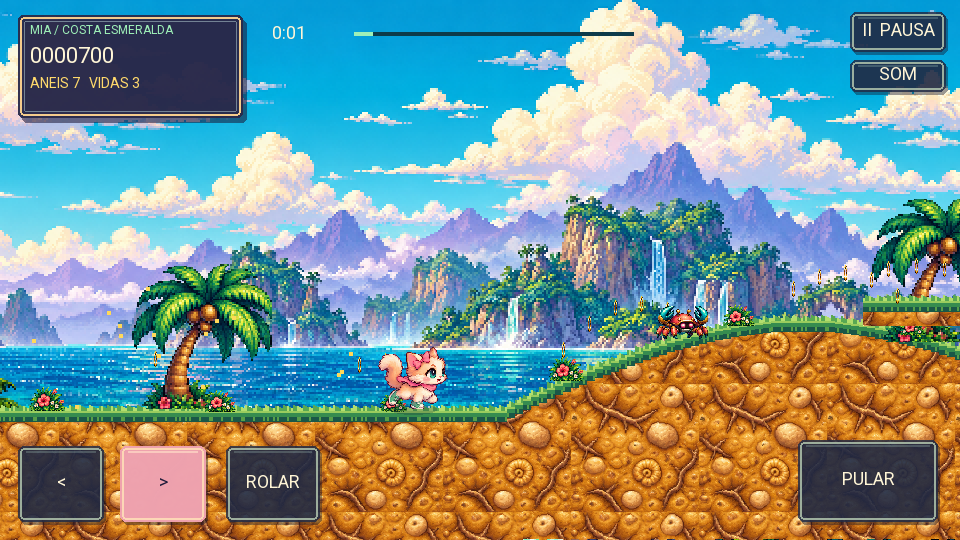
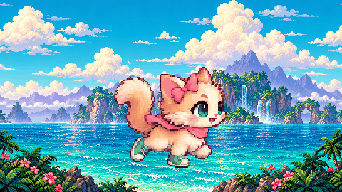

# Mia: Costa Esmeralda

Jogo de plataforma em **LÖVE 11.5**, inspirado nas corridas clássicas de 16 bits. Mia é uma gatinha fofinha com lacinho rosa, pelagem sombreada e animações de corrida, pulo e rolamento. A fase tem litoral, cachoeiras, palmeiras, flores, anéis, robôs, checkpoint e chefe.



## Baixar e jogar

A [versão 1.1.0](https://github.com/paulor8bit/mia-costa-esmeralda/releases/tag/v1.1.0) inclui:

- **Mia-Costa-Esmeralda.apk** — Android, com LÖVE incorporado; instale por cima da versão anterior.
- **Mia-Costa-Esmeralda.love** — versão portátil para abrir com LÖVE 11.5.
- GIF da Mia e prévias da fase e do menu.



## Controles

No celular: esquerda/direita, **ROLAR** e **PULAR**. Para carregar o impulso, segure ROLAR parado, toque PULAR e depois solte ROLAR. Pule sobre os robôs e o chefe.

No computador: setas ou A/D, espaço para pular, baixo/S para rolar, P para pausa e M para som.

## Estrutura

- `game/` — código Lua e assets usados pelo jogo.
- `art/source/` — fontes da nova arte, geradas com a ferramenta integrada image_gen.
- `art/PROMPTS.md` — prompts completos da arte.
- `art/previous/` — arte da versão anterior.
- `android/` — base Android incorporada do LÖVE, com recursos, DEX e bibliotecas nativas.
- `tools/` — preparação dos sprites, verificações, prévias e empacotamento.
- `docs/` — imagens de apresentação do projeto.

As prévias são renderizadas offline a partir dos comandos de desenho do jogo; não são capturas de tela do Android.

## Executar e verificar

Com LÖVE 11.5 instalado, execute na raiz do repositório:

```sh
love game
```

Com LuaJIT instalado, execute na raiz do repositório:

```sh
luajit tools/check.lua
```

São verificados: configuração antes da carga dos módulos, movimento, pulo, impulso, dano, checkpoint, vitória, fim de jogo e carga/desenho com stub de LÖVE. A versão 1.1.0 passou nessas verificações e nas verificações de integridade, alinhamento e assinatura do APK. O teste visual desta versão em aparelho Android ainda precisa ser confirmado.

## Preparar arte e compilar no Termux

Requer Python com Pillow, Java, `aapt2`, `apksigner` e uma chave de desenvolvimento Android em `~/.android/debug.keystore`. A chave não faz parte deste repositório. O script de build usa o alias e a senha padrão da chave de desenvolvimento Android.

```sh
python -m pip install pillow
curl -L https://github.com/iBotPeaches/Apktool/releases/download/v3.0.3/apktool_3.0.3.jar -o tools/apktool.jar
python tools/pack_art.py
python tools/build.py
```

Os arquivos compilados ficam em `releases/`. O gerador `tools/make_assets.py` é legado e recria a arte antiga; para restaurar a arte nova, execute `tools/pack_art.py`.

## Componentes de terceiros

O runtime Android vem de [LÖVE 11.5](https://github.com/love2d/love-android), e o build usa [Apktool](https://github.com/iBotPeaches/Apktool). Esses componentes mantêm suas respectivas licenças. A arte nova e o código do jogo estão neste repositório; as fontes de geração e os prompts foram preservados.
